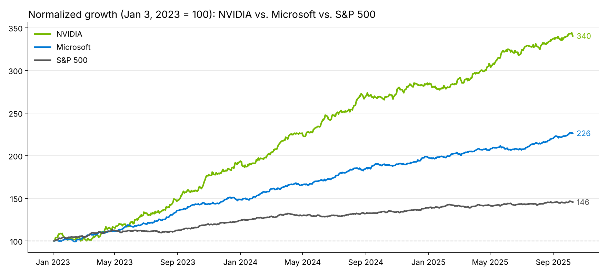

# AI Stocks Dashboard: NVIDIA vs. Microsoft vs. S&P 500

An interactive Tableau dashboard that compares how NVIDIA (NVDA) and Microsoft (MSFT) traded against the S&P 500 between January 2023 and October 2025, and links price and volume spikes to AI-related earnings events.

*Chart recreated in Python from the workbook's data so it can display on GitHub. The original interactive version is in the Tableau workbook. Data is a course-provided practice dataset, so values may differ from actual market prices.*

## Views

| Sheet | What it shows |
| --- | --- |
| Stock Price Comparison | Closing prices for NVDA, MSFT and the S&P 500, with key events annotated |
| Normalized Growth | All three rebased to 100 on Jan 3, 2023, so growth is directly comparable |
| Monthly Volume Comparison | NVDA vs. MSFT trading volume by month |
| Price vs. Volume Scatter | Each trading day plotted by price and volume, with event days highlighted |

A dashboard action filters every view by date.

## Takeaways

- In this dataset, NVDA ended at 340 vs. 226 for MSFT and 146 for the S&P 500 (all starting at 100). NVDA showed the most dramatic price increase, reflecting strong AI demand. MSFT grew steadily, and the S&P 500 moved most gradually.
- Volume spikes lined up with major events such as the Q1 2023 and Q3 2024 NVDA earnings releases.
- Event days stand out as the largest points in the scatter plot, where price and volume surged together.

> **Normalized growth** rebases each series to 100 on the same start date. A value of 250 means the stock is worth 2.5× what it was on day one, so stocks with very different prices can share one chart.

## Files

- `AI_Stocks_Dashboard.twbx`: packaged workbook with the course-provided daily dataset (723 trading days)

**Tools:** Tableau (calculated fields, dual-axis charts, dashboard actions, annotations)
