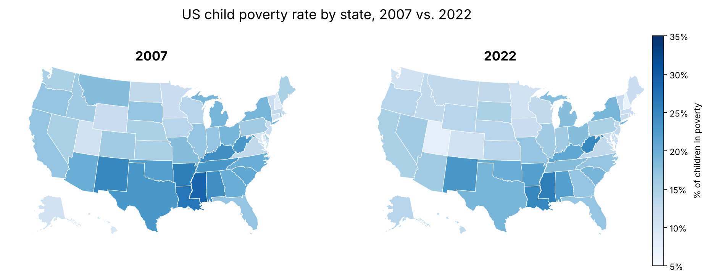

# US Child Poverty by State, 2007–2022

A Tableau storyboard of US child poverty rates every five years (2007, 2012, 2017, 2022), framed as a briefing for UNICEF on where to focus intervention efforts.

*Maps recreated in Python from the workbook's data so they can display on GitHub. The full four-year Tableau story is in the workbook.*

In 2022, the highest rates were in Mississippi (26%), Louisiana (25%), West Virginia (25%), New Mexico (23%) and Alabama (22%).

## Story

| Story point | Finding |
| --- | --- |
| 2007 | The highest child poverty rates cluster in Southern states. |
| 2012 | The geographic disparity persists, and the South remains most severe. |
| 2017 | Rates begin improving nationally, but the South still has the highest concentration. |
| 2022 | The core finding holds: child poverty remains concentrated in the South. |
| Conclusion | Prioritize Mississippi, Louisiana, New Mexico and neighboring states, where poverty is chronic and support can have the most impact. |

Each map is a **choropleth**, meaning a map where darker shading marks a higher value. It covers the continental US, Alaska and Hawaii.

## Data

[KIDS COUNT Data Center](https://datacenter.aecf.org/) (Annie E. Casey Foundation), children in poverty by state, based on the US Census Bureau's American Community Survey (ACS). The data is packaged inside the workbook.

## Files

- `US_Child_Poverty_2007_2022.twbx`: packaged workbook (4 map dashboards plus a story with captions)

**Tools:** Tableau (filled maps, story points, consistent color scales across years)
